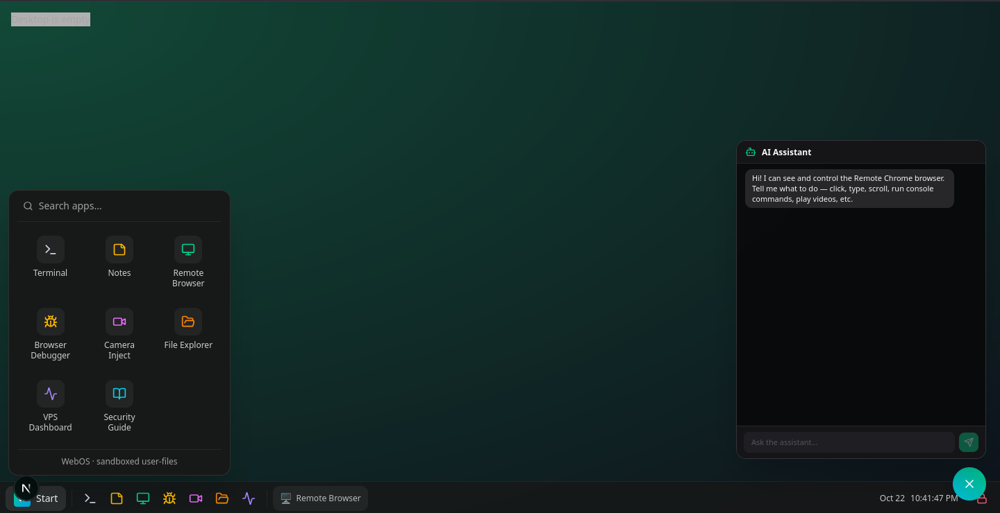
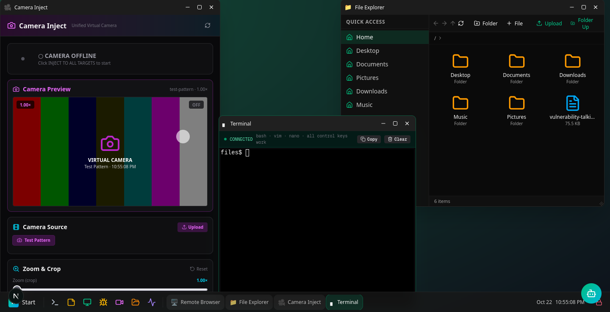

# WebOSA web-based desktop environment featuring remote browser control, virtual camera injection, terminal access, security tools, and advanced file management. Built with Next.js 16, React 19, TypeScript, and Bun.## Preview
  

  

  
> 📖 **Full setup instructions:** see [SETUP.md](SETUP.md) for detailed installation, configuration, and deployment guide.## OverviewWebOS transforms your browser into a full-featured operating system with 10+ integrated applications. From AI-powered browser automation to security reconnaissance tools, WebOS provides a complete desktop experience entirely in the browser with session-based authentication and real-time features.## Key Features### Security- **Session-based authentication** with NextAuth.js (no client-side secrets)- **Secure session management** with NextAuth.js- **Input validation and sanitization** across all APIs- **No client-side secrets** - all sensitive operations server-side- **Prisma ORM** with parameterized queries preventing SQL injection- **Virtual camera injection** for privacy protection### Performance- **Next.js 16** with React 19 for optimal rendering- **Bun runtime** for fast package management- **Standalone output** for minimal production bundle- **Code splitting** and lazy loading for fast app launches- **WebSocket connections** for real-time communication- **CDP (Chrome DevTools Protocol)** for efficient browser control- **In-memory caching** for frequently accessed data- **Server-Sent Events (SSE)** for streaming AI responses## Applications### 1. AI Browser AssistantAn intelligent AI agent that can see and control your browser through vision and natural language commands.**Features:**- **Vision-based automation** - AI sees screenshots and understands page layout- **Natural language control** - Tell the AI what to do in plain English- **Real-time action execution** - Click, type, scroll, navigate, run JavaScript- **Step-by-step transparency** - See every action the AI takes
